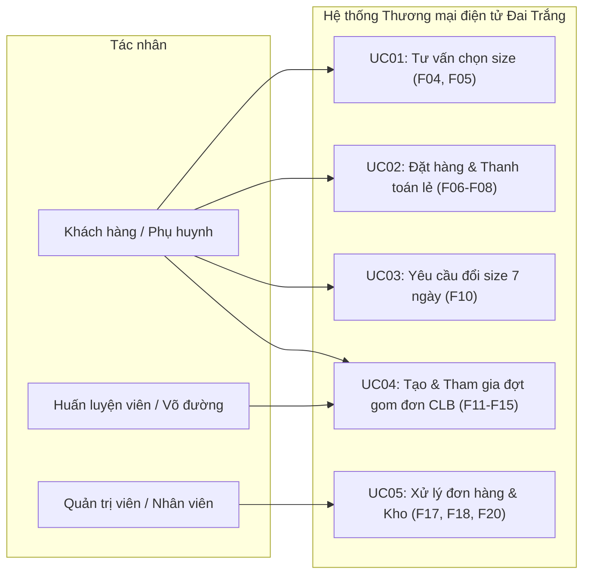

# Tài liệu Sơ đồ & Đặc tả Ca sử dụng (docs/02-use-case.md)

> **Dự án**: Website Thương mại điện tử Võ phục & Dụng cụ Võ thuật "Đai Trắng"  
> **Cơ sở dữ liệu**: MongoDB Atlas  

---

## 1. Sơ đồ Ca sử dụng Tổng quát (Mermaid)

---

## 2. Đặc tả 5 Ca Sử dụng Trọng tâm

### Ca sử dụng 1: Tư vấn chọn size thông minh (F04, F05)
- **Tác nhân**: Khách hàng (hoặc Khách vãng lai).
- **Tiền điều kiện**: Người dùng truy cập trang sản phẩm hoặc trang công cụ tư vấn size.
- **Luồng chính**:
  1. Khách hàng nhập các chỉ số: Chiều cao (cm), Cân nặng (kg), Độ tuổi và Môn võ quan tâm (Vovinam, Taekwondo, Karate, Võ cổ truyền).
  2. Hệ thống gửi yêu cầu đến API `/api/v1/size-advisor/recommend`.
  3. Hệ thống đối chiếu dữ liệu với bảng size chuẩn (`size_charts`) được lưu trong MongoDB Atlas.
  4. Hệ thống tính toán và trả về kết quả gồm: Size đề xuất (`recommended_size`), Size dự phòng (`backup_size`), Lời khuyên độ vừa vặn (`fit_note`), và cam kết đổi size miễn phí.
  5. Khách hàng đã đăng nhập có thể chọn lưu kết quả vào Hồ sơ size cá nhân (`student_profiles`) để tái sử dụng nhanh cho các lần đặt hàng tiếp theo.
- **Luồng thay thế**:
  - *4a. Số đo nằm giữa hai size*: Hệ thống tự động ưu tiên gợi ý size lớn hơn kèm thông báo giải thích để võ sinh thoải mái khi di chuyển tấn pháp.
  - *4b. Số đo ngoài bảng size (thấp hơn chuẩn nhỏ nhất hoặc vượt chuẩn lớn nhất)*: Hệ thống hiển thị cảnh báo ngoài khoảng chuẩn, đề xuất size biên gần nhất kèm hướng dẫn liên hệ tư vấn may đo riêng.
- **Hậu điều kiện**: Kết quả size được hiển thị trên giao diện và sẵn sàng áp dụng vào giỏ hàng.

---

### Ca sử dụng 2: Đặt hàng và Thanh toán (F06, F07, F08)
- **Tác nhân**: Khách hàng, Hệ thống MoMo, Đơn vị vận chuyển.
- **Tiền điều kiện**: Giỏ hàng có tối thiểu một sản phẩm và sản phẩm còn tồn kho.
- **Luồng chính (Thanh toán MoMo)**:
  1. Khách hàng kiểm tra giỏ hàng, tùy chọn dịch vụ thêu tên riêng (nếu có).
  2. Khách hàng nhập địa chỉ nhận hàng; hệ thống tính phí vận chuyển theo vùng nội/ngoại thành.
  3. Khách hàng chọn phương thức thanh toán MoMo và nhấn "Xác nhận đặt hàng".
  4. Hệ thống giữ chỗ tồn kho (khóa tạm 15 phút), tạo bản ghi đơn hàng với trạng thái `pending_payment`.
  5. Hệ thống tạo yêu cầu thanh toán ký số HMAC-SHA256 và chuyển hướng khách sang cổng MoMo.
  6. Khách hàng quét mã QR MoMo và thanh toán thành công.
  7. MoMo gửi thông báo xác nhận thanh toán (IPN) ngầm về máy chủ.
  8. Hệ thống xác thực chữ ký IPN, chuyển trạng thái đơn hàng sang `paid`, trừ hẳn tồn kho trong CSDL và gửi email/thông báo xác nhận đơn.
- **Luồng thay thế**:
  - *3a. Khách chọn COD*: Chỉ khả dụng khi đơn hàng không có sản phẩm thêu tên riêng. Hệ thống trừ tồn kho ngay và chuyển trạng thái đơn sang `confirmed`.
  - *6a. Khách hủy thanh toán hoặc quá hạn 15 phút*: Hệ thống tự động hoàn lại tồn kho đã giữ chỗ và chuyển trạng thái đơn sang `cancelled`.
- **Hậu điều kiện**: Đơn hàng được tạo thành công với mã định danh duy nhất `DT-YYYYMMDD-XXXX`.

---

### Ca sử dụng 3: Yêu cầu Đổi size trong vòng 7 ngày (F10)
- **Tác nhân**: Khách hàng, Nhân viên vận hành.
- **Tiền điều kiện**: Đơn hàng đã ở trạng thái `delivered` (Giao hàng thành công) và thời gian chưa vượt quá 7 ngày; sản phẩm không thêu tên riêng.
- **Luồng chính**:
  1. Khách hàng vào danh sách đơn hàng đã nhận, bấm "Yêu cầu đổi size".
  2. Khách hàng chọn sản phẩm cần đổi, chọn size mới mong muốn, nhập lý do và đính kèm hình ảnh minh chứng.
  3. Hệ thống kiểm tra điều kiện thời gian (<= 7 ngày) và lưu bản ghi yêu cầu đổi trả (`return_requests`) với trạng thái `pending`.
  4. Nhân viên vận hành duyệt yêu cầu đổi size trên trang quản trị.
  5. Hệ thống sinh đơn đổi hàng mới và gửi hướng dẫn gửi lại hàng cho khách.
  6. Khi kho nhận lại hàng trả, nhân viên xác nhận và hệ thống cộng lại tồn kho của size cũ.
- **Luồng thay thế**:
  - *2a. Đơn hàng đã quá 7 ngày kể từ lúc giao*: Hệ thống khóa nút đổi size và hiển thị thông báo chính sách đổi trả đã hết hạn.
  - *2b. Sản phẩm đã thêu tên riêng*: Hệ thống từ chối yêu cầu đổi trả theo quy định đã công bố.
- **Hậu điều kiện**: Yêu cầu đổi size được hoàn tất, dữ liệu tồn kho được cập nhật chính xác.

---

### Ca sử dụng 4: Đặt hàng theo đợt chung cho Võ đường / CLB (F11–F15)
- **Tác nhân**: Huấn luyện viên (HLV), Phụ huynh / Võ sinh, Quản trị viên.
- **Tiền điều kiện**: Võ đường đã được Quản trị viên phê duyệt kích hoạt trên hệ thống.
- **Luồng chính**:
  1. HLV tạo đợt gom đơn (`club_campaigns`): Chọn danh mục võ phục áp dụng, số lượng dự kiến (ví dụ: 50 bộ), thời hạn chốt đơn và tùy chọn thêu logo CLB.
  2. Quản trị viên duyệt đợt và hệ thống xác định bậc giá sỉ (chiết khấu 10%–25% theo số lượng dự kiến).
  3. Hệ thống tạo đường dẫn liên kết riêng và mã QR chia sẻ cho phụ huynh võ sinh.
  4. Phụ huynh quét mã QR, chọn sản phẩm, nhập số đo để hệ thống tư vấn size, nhập tên võ sinh và thanh toán.
  5. HLV theo dõi danh sách đặt hàng theo thời gian thực trên giao diện quản trị CLB và xuất báo cáo CSV.
  6. Khi đến hạn chốt đợt, HLV đóng chiến dịch và thực hiện đặt cọc 50% qua MoMo.
  7. Hệ thống tự động gom toàn bộ đơn thành 1 lô hàng giao về địa chỉ võ đường.
- **Hậu điều kiện**: Toàn bộ võ sinh trong đợt nhận đúng kích cỡ đồng phục và võ đường hưởng mức giá chiết khấu sỉ.

---

### Ca sử dụng 5: Xử lý Đơn hàng & Quản lý Kho của Quản trị (F17, F18, F20)
- **Tác nhân**: Nhân viên vận hành (Staff), Quản trị viên (Admin).
- **Tiền điều kiện**: Đăng nhập bằng tài khoản có vai trò `admin` hoặc `staff`.
- **Luồng chính**:
  1. Nhân viên xem danh sách đơn hàng mới lọc theo trạng thái (`confirmed`, `paid`).
  2. Nhân viên chuyển trạng thái đơn hàng sang `processing` (Đang đóng gói) và in phiếu đóng gói.
  3. Nhân viên tạo vận đơn giao hàng thông qua mô-đun vận chuyển, nhận mã vận đơn và chuyển trạng thái sang `shipping`.
  4. Khi đơn vị vận chuyển báo giao thành công, trạng thái chuyển sang `delivered`.
  5. Hệ thống lưu vết chi tiết lịch sử mỗi lần chuyển trạng thái (`OrderStatusHistory`): Trạng thái cũ, trạng thái mới, người thao tác, thời gian, ghi chú.
- **Luồng thay thế**:
  - *2a. Hủy đơn hàng trước khi vận chuyển*: Khách hàng hoặc Nhân viên yêu cầu hủy đơn; hệ thống tự động hoàn lại tồn kho trong CSDL MongoDB.
  - *2b. Phát hiện tồn kho dưới ngưỡng cảnh báo*: Hệ thống hiển thị cảnh báo tồn thấp (`is_low_stock`), nhân viên thực hiện thao tác nhập kho bổ sung và ghi nhận `StockMovement`.
- **Hậu điều kiện**: Luồng đơn hàng được xử lý chính xác theo quy trình và lịch sử hoạt động được ghi nhận đầy đủ.
