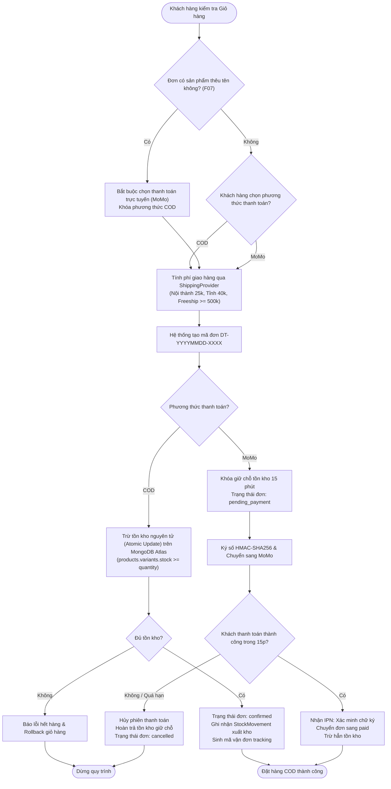
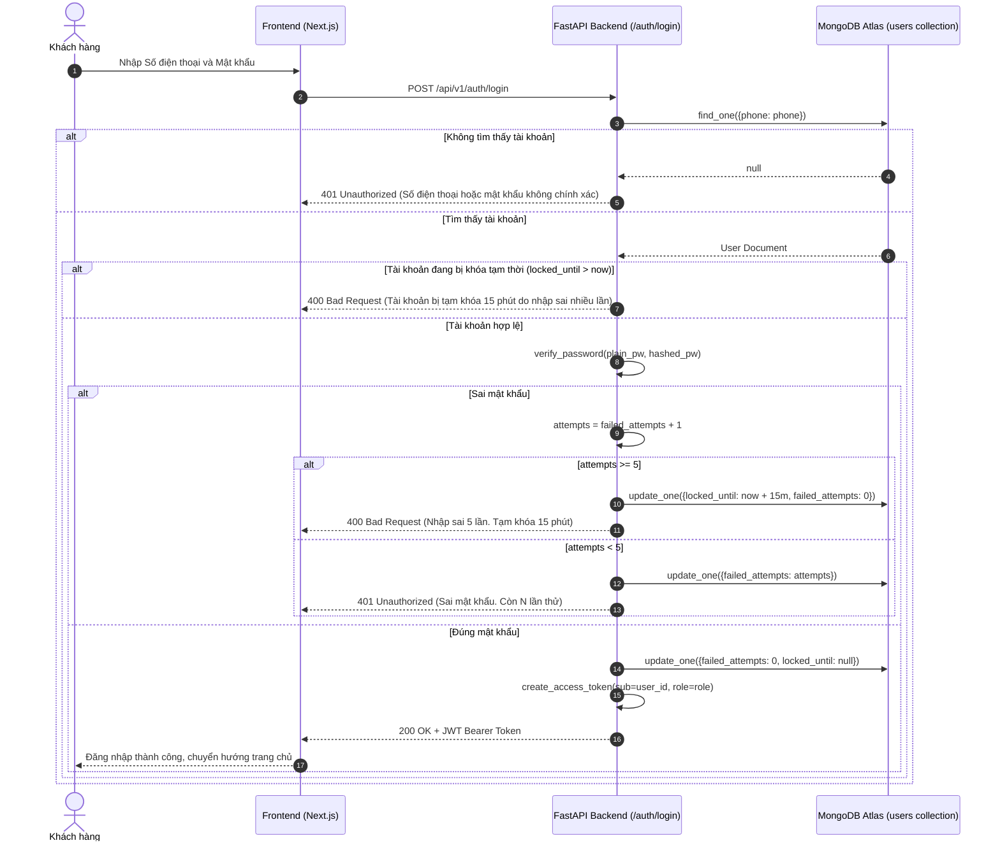
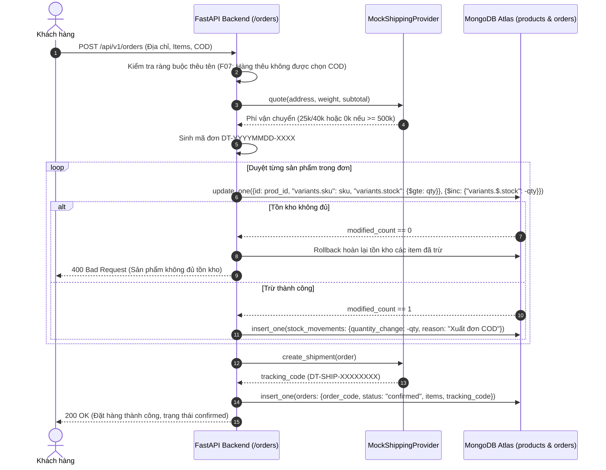

# Sơ đồ Hoạt động & Sơ đồ Tuần tự Hệ thống (docs/03-hoat-dong-tuan-tu.md)

> **Dự án**: Website Thương mại điện tử Võ phục & Dụng cụ Võ thuật "Đai Trắng"  
> **Cơ sở dữ liệu**: MongoDB Atlas  

---

## 1. Sơ đồ Hoạt động: Đặt hàng & Trừ tồn kho (F06, F07, F08)

---

## 2. Sơ đồ Tuần tự: Đăng nhập & Cơ chế Chống Dò Mật khẩu (F01, Mục 9)

---

## 3. Sơ đồ Tuần tự: Đặt hàng COD & Trừ Tồn kho Tức thời (F08)

