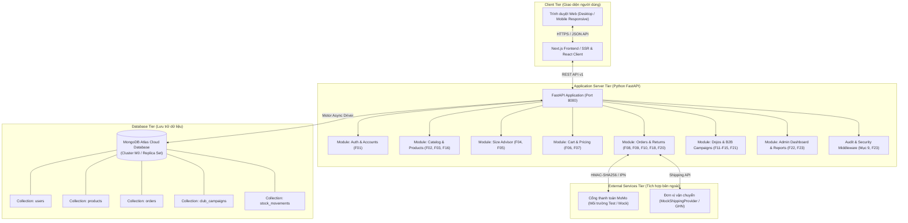

# Tài liệu Kiến trúc Hệ thống (docs/04-kien-truc.md)

> **Dự án**: Website Thương mại điện tử Võ phục & Dụng cụ Võ thuật "Đai Trắng"  
> **Cơ sở dữ liệu**: MongoDB Atlas  

---

## 1. Sơ đồ Kiến trúc Hệ thống Tổng quan



---

## 2. Công nghệ Sử dụng và Lý do Lựa chọn

1. **Cơ sở dữ liệu: MongoDB Atlas (Cloud NoSQL Database)**
   - *Lý do*: Theo yêu cầu đồ án chỉ định sử dụng MongoDB Atlas. Kiến trúc Document của MongoDB cực kỳ thích hợp cho mô hình thương mại điện tử linh hoạt (biến thể kích thước, màu sắc, hồ sơ võ sinh lồng nhau, lịch sử trạng thái đơn hàng). Cụm MongoDB Atlas Replica Set phân tán giúp hệ thống đạt độ sẵn sàng cao (High Availability) và khả năng mở rộng (Scalability) tức thì mà không cần cài đặt máy chủ database cục bộ phức tạp.
2. **Backend Framework: Python 3.9+ & FastAPI**
   - *Lý do*: FastAPI là framework hiện đại, hiệu năng tiệm cận NodeJS và Go nhờ kiến trúc bất đồng bộ `asyncio` chuẩn ASGI. FastAPI tự động sinh tài liệu Swagger/OpenAPI (`/docs`), tích hợp Pydantic v2 kiểm soát kiểu dữ liệu nghiêm ngặt và hỗ trợ driver `motor` (MongoDB Async Python Driver) tốt nhất.
3. **Frontend: Next.js (React) & Tailwind CSS / Bootstrap 5**
   - *Lý do*: Hỗ trợ render phía máy chủ (SSR) phục vụ tối ưu hóa công cụ tìm kiếm (SEO) theo yêu cầu F24, giao diện thân thiện với thiết bị di động (Mobile First).

---

## 3. Cấu trúc Thư mục Dự án

```text
TMĐT/
├── docs/                             # Tài liệu kỹ thuật hoàn chỉnh (Mục 12)
│   ├── 01-yeu-cau.md                 # Đặc tả yêu cầu F01-F24 & NFR
│   ├── 04-kien-truc.md               # Kiến trúc hệ thống & sơ đồ
│   ├── 05-csdl.md                    # Thiết kế CSDL MongoDB Atlas
│   ├── 06-bao-mat.md                 # Kế hoạch an ninh & bảo mật
│   └── gia-dinh.md                   # Các giả định nghiệp vụ
└── TMDT-NHOM-2/
    ├── backend/                      # Ứng dụng Backend FastAPI
    │   ├── app/
    │   │   ├── core/                 # Cấu hình, database MongoDB Atlas, security, auth
    │   │   │   ├── config.py
    │   │   │   ├── database.py       # Kết nối Motor MongoDB Atlas & Mongomock
    │   │   │   ├── dependencies.py   # RBAC & Token Auth
    │   │   │   └── security.py       # Bcrypt, JWT
    │   │   ├── modules/              # Các phân hệ nghiệp vụ
    │   │   │   ├── auth/             # F01: Đăng ký, đăng nhập, bảo vệ brute force
    │   │   │   ├── users/            # Quản lý tài khoản & hồ sơ size võ sinh
    │   │   │   ├── products/         # F02, F03, F16: Danh mục, sản phẩm, biến thể
    │   │   │   ├── size_advisor/     # F04, F05: Tư vấn size & hồ sơ size
    │   │   │   ├── cart/             # F06, F07: Giỏ hàng & thêu tên
    │   │   │   ├── orders/           # F08-F10: Đơn hàng, thanh toán, đổi trả
    │   │   │   ├── dojos/            # F11-F15: Võ đường & chiến dịch B2B
    │   │   │   └── admin/            # F18-F23: Quản trị, báo cáo, nhật ký
    │   │   ├── main.py               # Điểm khởi chạy FastAPI
    │   │   └── api.py                # Tổng hợp Router API v1
    │   ├── tests/                    # Bộ kiểm thử tự động (Pytest)
    │   │   ├── conftest.py           # Fixture AsyncClient & Mongomock DB
    │   │   └── test_auth_f01.py      # Test F01 & Bảo mật
    │   ├── .env                      # Cấu hình biến môi trường cục bộ
    │   ├── .env.example              # Mẫu cấu hình MONGODB_URI
    │   └── requirements.txt          # Danh sách thư viện Python
    └── frontend/                     # Ứng dụng Giao diện người dùng
```
