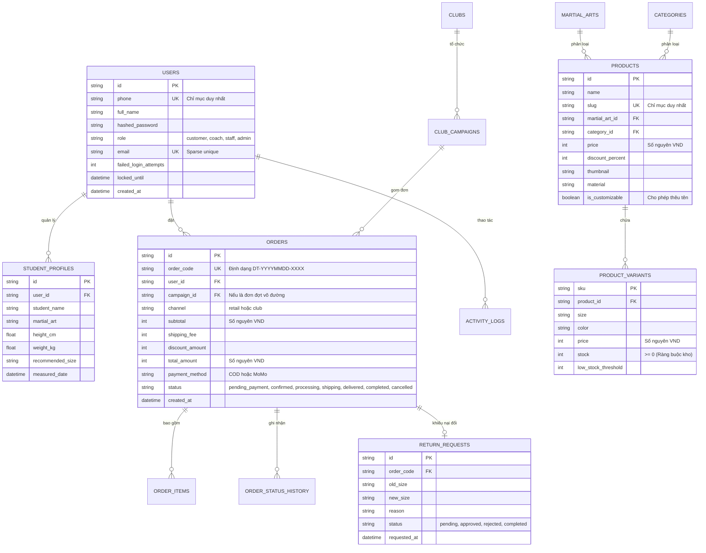

# Thiết kế Cơ sở dữ liệu MongoDB Atlas (docs/05-csdl.md)

> **Dự án**: Website Thương mại điện tử Võ phục & Dụng cụ Võ thuật "Đai Trắng"  
> **Cơ sở dữ liệu**: MongoDB Atlas (NoSQL Document Store)  

---

## 1. Sơ đồ Quan hệ Thực thể Logic (ERD)



---

## 2. Từ điển Dữ liệu các Collections trên MongoDB Atlas

### 2.1. Collection `users`
Lưu trữ thông tin tài khoản khách hàng, HLV võ đường, nhân viên vận hành và quản trị viên.

| Trường | Kiểu dữ liệu | Ràng buộc | Ý nghĩa / Ghi chú |
|---|---|---|---|
| `_id` | ObjectId | Khóa chính MongoDB | Định danh bản ghi nội bộ |
| `id` | String | Unique Index | Mã định danh dạng UUID chuẩn |
| `phone` | String | Unique Index | Số điện thoại đăng nhập chính thức |
| `full_name` | String | Not null | Họ và tên người dùng |
| `hashed_password` | String | Not null | Mật khẩu băm an toàn bằng Bcrypt (Mục 9) |
| `role` | String | Index | `customer`, `coach`, `staff`, `admin` |
| `email` | String | Sparse Unique | Email cá nhân (tùy chọn) |
| `address` | String | Nullable | Địa chỉ giao hàng mặc định |
| `failed_login_attempts` | Integer | Default 0 | Số lần nhập sai mật khẩu liên tiếp |
| `locked_until` | DateTime | Nullable | Thời điểm mở khóa tài khoản (khóa 15 phút) |
| `reset_token` | String | Nullable | Mã OTP / Token khôi phục mật khẩu |
| `reset_token_expires_at`| DateTime | Nullable | Thời hạn của token quên mật khẩu |
| `is_active` | Boolean | Default True | Trạng thái kích hoạt tài khoản |
| `created_at` | DateTime | Default Now | Thời điểm tạo tài khoản |

### 2.2. Collection `products`
Lưu trữ danh mục sản phẩm võ phục, đai, dụng cụ bảo hộ và các biến thể kích thước / màu sắc.

| Trường | Kiểu dữ liệu | Ràng buộc | Ý nghĩa / Ghi chú |
|---|---|---|---|
| `id` | String | Unique Index | Mã định danh sản phẩm |
| `name` | String | Not null | Tên sản phẩm |
| `slug` | String | Unique Index | Đường dẫn URL thân thiện chuẩn SEO |
| `martial_art_id` | String | Index | Môn võ: `vovinam`, `taekwondo`, `karate`, `vo_co_truyen` |
| `category_id` | String | Index | Loại: `vo_phuc`, `dai`, `bao_ho`, `tui_dung`, `phu_kien` |
| `price` | Integer | >= 0 | Giá niêm yết (VND, số nguyên) |
| `original_price` | Integer | Nullable | Giá gốc trước giảm (VND) |
| `thumbnail` | String | URL | Ảnh đại diện sản phẩm |
| `material` | String | Not null | Chất liệu vải (ví dụ: Kaki Cotton 100%) |
| `is_customizable` | Boolean | Default False| Hỗ trợ dịch vụ thêu tên riêng |
| `variants` | Array[Object] | Biến thể | Danh sách các biến thể SKU, size, màu sắc, tồn kho (`stock`), ngưỡng cảnh báo (`low_stock_threshold`) |

### 2.3. Collection `stock_movements` (Lịch sử Biến động Kho - F17)
Lưu trữ toàn bộ dấu vết biến động số lượng xuất - nhập - hoàn tồn kho theo từng SKU biến thể:

| Trường | Kiểu dữ liệu | Ràng buộc | Ý nghĩa / Ghi chú |
|---|---|---|---|
| `id` | String | Unique Index | Mã giao dịch biến động (UUID) |
| `product_id` | String | Index | Mã sản phẩm liên quan |
| `sku` | String | Index | Mã SKU biến thể kích cỡ / màu sắc |
| `quantity_change` | Integer | != 0 | Số lượng thay đổi (Âm `-` khi bán ra, Dương `+` khi nhập kho/hoàn đơn) |
| `reason` | String | Not null | Lý do biến động (Bán hàng, Khách hủy đơn, Nhập kho mới, Hoàn hàng đổi size) |
| `performed_by` | String | Not null | Người thực hiện (Mã khách hàng, Staff ID hoặc Hệ thống) |
| `created_at` | DateTime | Index | Thời điểm ghi nhận biến động kho |

---

## 3. Các Ràng buộc Toàn vẹn & Cơ chế Cộng Trừ Tồn Kho trên MongoDB Atlas

1. **Cơ chế Bán ra (Trừ tồn kho nguyên tử - Atomic Deduction)**:
   - Khi khách đặt hàng thành công (đơn COD) hoặc MoMo gửi webhook IPN thanh toán:
   - Sử dụng toán tử điều kiện nguyên tử của MongoDB để kiểm tra và trừ tồn kho trong cùng 1 transaction:
     ```python
     result = await db["products"].update_one(
         {
             "id": product_id,
             "variants.sku": sku,
             "variants.stock": {"$gte": quantity}  # ĐIỀU KIỆN: Tồn kho phải lớn hơn hoặc bằng số lượng mua
         },
         {"$inc": {"variants.$.stock": -quantity}}  # TRỪ NGUYÊN TỬ TỨC THÌ
     )
     ```
   - Nếu `result.modified_count == 0`: Hệ thống lập tức ném lỗi `400 Bad Request` thông báo không đủ hàng và hủy giao dịch, **triệt tiêu 100% rủi ro bán vượt tồn kho (oversell)**.
   - Đồng thời tự động ghi 1 bản ghi vào collection `stock_movements` với `quantity_change = -quantity`.

2. **Cơ chế Hủy đơn & Đổi trả (Cộng hoàn tồn kho - Restock)**:
   - Khi đơn hàng bị hủy trước lúc vận chuyển (`/orders/{order_code}/cancel`):
     ```python
     await db["products"].update_one(
         {"id": product_id, "variants.sku": sku},
         {"$inc": {"variants.$.stock": quantity}}  # CỘNG TRẢ LẠI KHO
     )
     ```
   - Khi nhân viên kho xác nhận nhận lại kiện hàng đổi size (`/admin/returns/{id}/receive`):
     Tồn kho SKU của size cũ tự động được cộng thêm 1 đơn vị (`$inc: {"variants.$.stock": 1}`).
   - Ghi nhận `stock_movements` với `quantity_change = +quantity`.

3. **Cơ chế Nhập kho / Kiểm kê kho thủ công (F17)**:
   - Nhân viên kho sử dụng API `/orders/inventory/adjust`:
     - Nhập hàng mới: truyền `quantity_change > 0` -> tồn kho tăng.
     - Xuất kho / loại bỏ hàng lỗi: truyền `quantity_change < 0` kèm ràng buộc `variants.stock >= abs(quantity_change)` để tồn kho không bao giờ bị âm.
   - Ghi nhận đầy đủ nhật ký biến động kho và Activity Log.
2. **Ràng buộc Duy nhất (Unique Indexes)**:
   - `users.phone`: Không cho phép trùng số điện thoại.
   - `products.slug`: Mỗi sản phẩm có slug SEO duy nhất.
   - `orders.order_code`: Mã đơn dạng `DT-YYYYMMDD-XXXX` là duy nhất toàn hệ thống.
